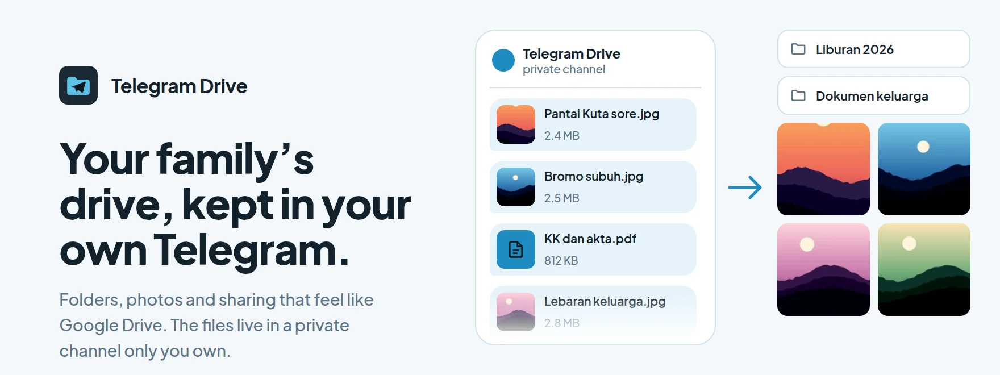
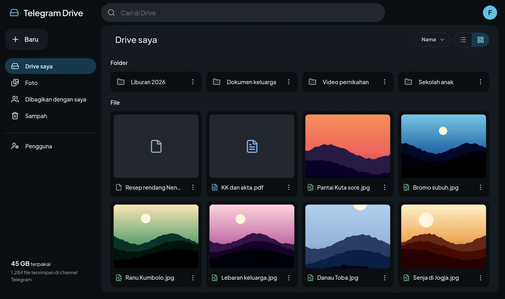
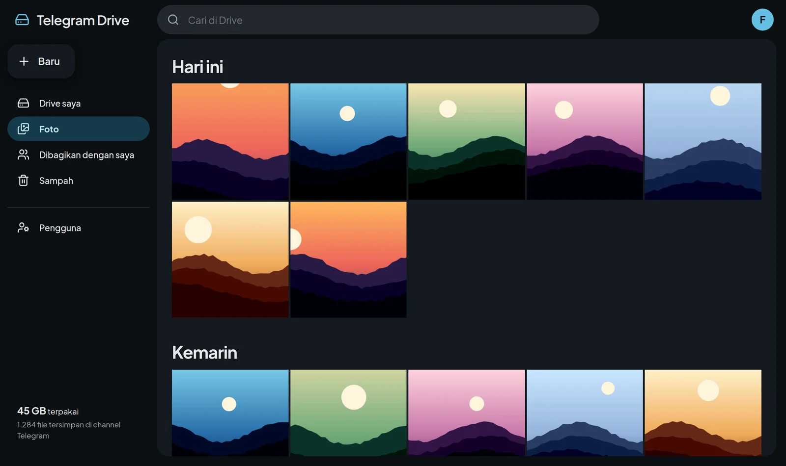
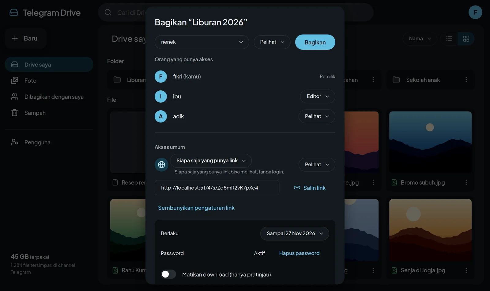
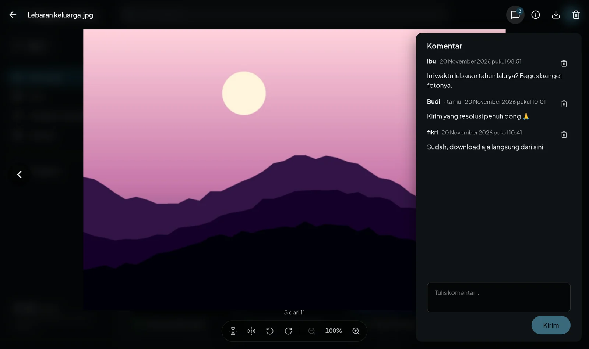

<h1 align="center">
  <picture>
    <source media="(prefers-color-scheme: dark)" srcset="docs/banner-dark.webp">
    
  </picture>
</h1>

<p align="center">
  <a href="https://github.com/pozzdol/telegram-drive/actions/workflows/ci.yml"></a>
  <a href="LICENSE"></a>
  
</p>

Install on a fresh Debian or Ubuntu server:

```bash
curl -fsSL https://raw.githubusercontent.com/pozzdol/telegram-drive/main/install.sh | sudo bash
```

**Telegram Drive** is a self-hosted drive for a family or a small team. Upload, browse, preview and share
files in a web app that feels like Google Drive, with a Google Photos-style timeline for pictures. The bytes go
to a private channel in your Telegram account; this server only keeps folders, names and accounts. One Go
binary serves the app and the API, and the installer sets everything up with one command.

<p align="center">
  
</p>

<table>
  <tr>
    <td width="33%"></td>
    <td width="33%"></td>
    <td width="33%"></td>
  </tr>
  <tr>
    <td align="center">Photos by the day they were taken</td>
    <td align="center">Share with family or with a link</td>
    <td align="center">Viewer with zoom and comments</td>
  </tr>
</table>

The interface is in Indonesian. It works on phones too, with a bottom tab bar, pinch to zoom and a long press to select.

## Install

### One command (recommended)

On a fresh **Debian or Ubuntu** server:

```bash
curl -fsSL https://raw.githubusercontent.com/pozzdol/telegram-drive/main/install.sh | sudo bash
```

The installer asks a few questions, then does the rest: it installs PostgreSQL, downloads the binary for your CPU
(checking its checksum), logs in to Telegram, creates a private storage channel, makes your admin account,
starts a hardened systemd service and, if you give it a domain, gets an HTTPS certificate through Caddy.

What it asks for:

| Step | You need | Where to get it |
| --- | --- | --- |
| Telegram API | API ID and API hash | [my.telegram.org](https://my.telegram.org) → API development tools |
| Telegram account | The phone number that stores the files, and the phone itself for the login code | Your Telegram app |
| Database | Nothing, or the URL of a PostgreSQL you already run | Installed for you by default |
| Web address | A domain whose DNS points at the server, or nothing to use `http://<ip>:5758` | Your DNS provider |
| Telegram login button | A bot token, optional | [@BotFather](https://t.me/BotFather) |
| Your account | An admin username and password | You choose |

Run the same command again later to **update** to the latest version.

Every answer can also come from an environment variable (`TD_API_ID`, `TD_API_HASH`, `TD_PHONE`,
`TD_DATABASE_URL`, `TD_DOMAIN`, …) for unattended installs; see the top of [install.sh](install.sh).
`TD_DRY_RUN=1` shows what it would change without changing anything.

### Other ways

| Setup | Guide |
| --- | --- |
| Another Linux, your own PostgreSQL or reverse proxy | [Self-hosting by hand](docs/self-hosting.md) |
| UI on Cloudflare Pages or Vercel, API behind Cloudflare Tunnel | [Split deployment](docs/self-hosting.md#split-deployment) |
| Running it from source to work on it | [Development](docs/development.md) |

## Features

- **Drive.** Folders, list and grid views, sorting, search, drag-and-drop upload, rename, move, right-click menus. Select with Ctrl/Cmd+A, Shift-click, a drag box, or a long press, then move or delete many items at once. Big folders load 50 items at a time as you scroll.
- **Photos.** Every photo and video in one timeline, grouped by the day it was taken (EXIF), with infinite scroll.
- **Viewer.** Zoom, pan, rotate and flip images; a video and audio player with its own controls; Markdown and text previews. The back button closes it, as on Google Drive.
- **Big files.** Resumable uploads in chunks, up to 2 GB per file (4 GB with Telegram Premium). Videos stream and seek.
- **Sharing.** Share a file or folder with family accounts as viewer, commenter or editor. A folder share covers everything inside it.
- **Public links.** One link per item, off by default: role, password, expiry date, guest name, downloads off, and a cap on guest uploads. The owner keeps full access and every change is logged.
- **Comments.** On any file, by owners, editors, commenters and link guests. The owner gets a Telegram message when someone comments.
- **Trash.** Deleted items wait 30 days, can be previewed and restored, and only then leave Telegram.
- **Accounts.** Private drives per person, no public sign-up, an admin page, optional *Log in with Telegram*.
- **Housekeeping.** Notices files deleted in Telegram itself, previews videos without ffmpeg, keeps uploads safe across restarts.

## How it works

```
 browser ──HTTPS──▶  telegram-drive (one Go binary: web app + JSON API)
                        │                      │
                        │ folders, names,      │ file bytes, as documents
                        │ accounts, shares     │ in a private channel
                        ▼                      ▼
                   PostgreSQL           your Telegram account (MTProto)
```

- The server logs in to Telegram as **your user account** (not a bot), so files keep Telegram's per-file limit
  instead of a bot's 50 MB, and the storage channel is yours.
- Uploads arrive in 50 MB chunks, are written to disk, then sent to Telegram in the background. Downloads read
  1 MiB pieces in parallel and support HTTP Range, so videos can seek.
- Without the database you still have the files in the channel, but not their names and folders. Back up both:
  `data/` (the Telegram session) and PostgreSQL.

## Scope

**What it is for:** a private drive for people you know, on a server you control, using storage you already have.

**What it is not:** a backup service, an end-to-end encrypted vault, or a way to host public downloads for
strangers. Those exclusions are deliberate. See the FAQ for why.

## FAQ

**Is there a storage limit?**
Telegram does not publish one for channels; each file can be up to 2 GB (4 GB with Premium). Telegram can change
that at any time.

**Is my data private?**
Only you and the people you share with can see it through the app. Telegram itself can technically read cloud
messages: channels are not end-to-end encrypted. Encrypt anything sensitive before uploading it.

**What if a file is deleted in Telegram directly?**
The drive notices (at opening time and on a check every 6 hours), marks it as missing, and offers to remove the
leftover record. The content cannot come back.

**Is this allowed by Telegram?**
Read [Telegram's terms of service](https://telegram.org/tos) for your use. Using your own account to store your
own files is common, but heavy automated use carries a risk you accept by running this.

**Can I use SQLite instead of PostgreSQL?**
Not yet. SQLite support is planned, so small installs will not need a database server.

**Can two servers share with each other?**
That is being designed in [docs/federation.md](docs/federation.md). Comments are welcome.

## Documentation

| Topic | |
| --- | --- |
| [Self-hosting by hand](docs/self-hosting.md) | Requirements, configuration, split deployment, keeping secrets, known limits |
| [Sharing, links, comments and the trash](docs/sharing.md) | Who can do what |
| [API](docs/api.md) | Every endpoint, and the chunked upload protocol |
| [Development](docs/development.md) | Running from source, project layout, checks before a pull request |
| [Federation (draft)](docs/federation.md) | Sharing between servers |

## Roadmap

- [x] Sharing with accounts and public links, comments, trash
- [x] One-command installer, UI built into the binary
- [ ] SQLite as an alternative to PostgreSQL
- [ ] Sharing between servers ([draft](docs/federation.md))
- [ ] Offline copies of shared folders

## Contributing

Issues and pull requests are welcome. Keep changes small and focused, run the checks in
[docs/development.md](docs/development.md#before-a-pull-request), and never commit `.env`, `data/` or a
Telegram session.

## License

[MIT](LICENSE)
